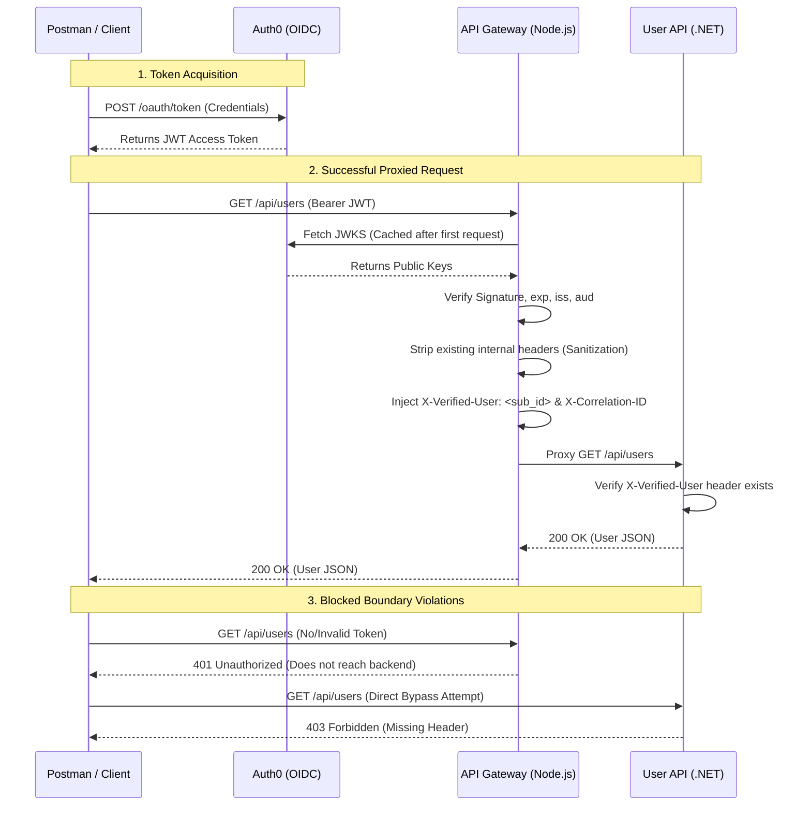

# Secure Entry Gateway PoC: Zero Trust Architecture

This repository contains a proof-of-concept Zero Trust architecture demonstrating strict perimeter defense, identity validation, and microservice isolation. 

## Project Structure
The repository is strictly divided to ensure clean separation between the perimeter gateway and the internal domain logic:
* `/gateway` - Node.js (TypeScript/Express) Zero Trust Perimeter
* `/backend` - .NET 8 Minimal API Internal Service

## Architectural Decisions & Evaluation Criteria

- **Microservices:** The API Gateway is built in **Node.js (TypeScript)** to leverage industry-standard edge-proxy identity middleware (`express-jwt`, `jwks-rsa`). The downstream User API is built as a **.NET Minimal API** to demonstrate high-performance, strongly-typed RESTful service execution.
- **Separation of Concerns:** Authentication is entirely offloaded to the Gateway. The .NET backend is completely unaware of JWTs, Identity Providers, or cryptographic validation, relying strictly on perimeter network enforcement and injected headers.
- **Security & Data Sanitization:** The Gateway explicitly strips/overwrites any inbound `X-Verified-User` headers from the public web to prevent header-spoofing attacks.
- **Standardized Error Handling:** Both the Gateway and the .NET backend are designed to return standard **RFC 7807 Problem Details** (`application/problem+json`) to ensure frontend consumers receive a predictable error contract without leaking sensitive stack traces.
- **Observability & Debuggability:** 
  - The Gateway automatically generates and injects an `X-Correlation-ID` into every request. 
  - Gateway telemetry outputs strictly structured JSON logs (`res.on('finish')`), capturing status codes, latencies, and correlation IDs for integration with enterprise log aggregators (e.g., Datadog, App Insights).

## Traffic Flow



## Setup Instructions

### 1. Gateway Configuration (.env)
Navigate to the `gateway/` directory and create/edit a `.env` file with the details below - these are for a test throwaway Auth0 tenant

**`.env`**
```env
AUTH0_ISSUER=https://dev-tims-ndia.au.auth0.com/
AUTH0_AUDIENCE=https://tim-zerotrust-gateway
AUTH0_JWKS_URI=https://dev-tims-ndia.au.auth0.com/.well-known/jwks.json
GATEWAY_PORT=3000
BACKEND_API_URI=http://localhost:3001
```

### 2. Running the Services
You will need two terminal instances to run the services concurrently.

**Terminal 1: Start the API Gateway**
```bash
cd gateway
npm install
npm run dev
```
*The Gateway will listen on `http://localhost:3000`*

**Terminal 2: Start the Backend Service**
```bash
cd backend
dotnet run
```
*The Backend will listen on `http://localhost:3001`*

## Testing Scenarios

### 1. Automated Integration Tests
The Gateway includes a Jest test suite utilizing `nock` to mock the Auth0 provider and the downstream .NET API. This guarantees offline, deterministic testing of the Zero Trust perimeter without external dependencies. 

```bash
cd gateway
npm test
```
*Tests explicitly verify:*
* JWT validation logic and IdP cryptographic rejection.
* Zero Trust blocking (requests without tokens are rejected at the edge).
* Context injection and proxy routing functionality.

### 2. Manual Success Flow (Postman/cURL)
To execute a successful end-to-end request, retrieve a valid token from Auth0 and submit the test url to the Gateway:

Reviewer Note: Authentication Setup
To help the review process, this project is wired to a dedicated, throwaway Auth0 test tenant. To generate a valid test JWT, use the included `NDIA-Challenge-Tim-Shepherd.postman_collection.json` file. It is pre-configured with a test Client ID and Secret to hit the `POST /oauth/token` Auth0 endpoint and automatically attach the resulting Bearer token to subsequent requests.

There are a set of testing urls within the Postman file that can be used for manual testing.

Note: For a production deployment, these credentials would be injected via a secure vault (e.g., Azure Key Vault / AWS Secrets Manager) and never committed to source control.

With each test, the Gateway terminal will output a structured JSON log containing the User ID, Correlation ID, and duration.

### 3. Manual Failure Scenarios
Prove the Zero Trust boundaries by simulating attacks:

- **Bypass the Gateway:** Send a request directly to the backend without the proxy header.
  ```bash
  curl --request GET --url http://localhost:3001/api/users
  ```
  **Expected Result:** `403 Forbidden`. The backend rejects the direct connection.
    
- **Unauthenticated Gateway Access:** Send a request to the Gateway without a token.
  ```bash
  curl --request GET --url http://localhost:3000/api/users
  ```
  **Expected Result:** `401 Unauthorized`. The Gateway instantly blocks the request, logging the failed attempt.
